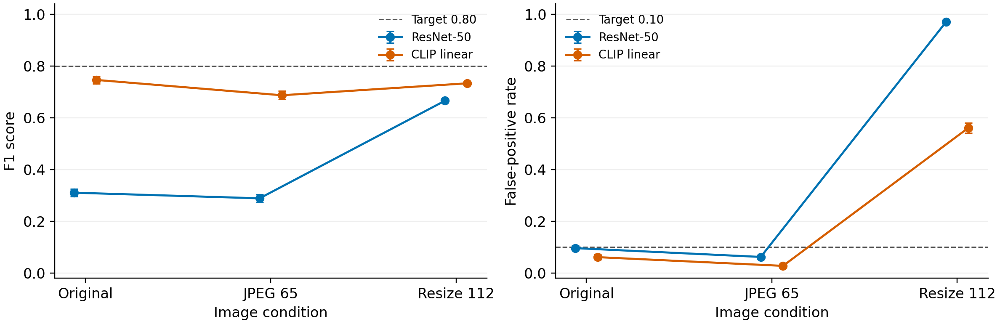
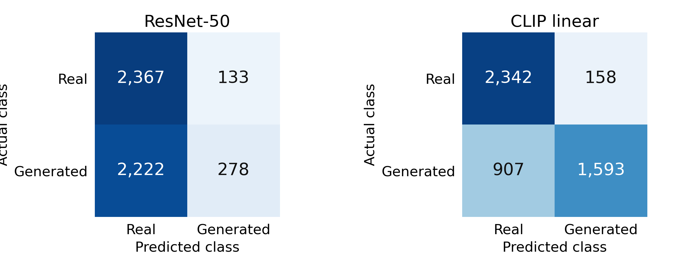

# AI-generated image detection

Afanasyev Kirill and Amangeldi Beksultan · Astana IT University, BDA-2403.

[Paper (PDF)](article/manuscript.pdf) · [LaTeX source](article/manuscript.tex) · [Citation](CITATION.cff)

The completed 6 November 2026 experiment refits ResNet-50 and a linear classifier on frozen CLIP ViT-B/32 features. Exact deduplication of the entire Tiny-GenImage mirror leaves **34,998 images**.

| Partition | Real | Generated | Total |
|---|---:|---:|---:|
| Training | 9,998 | 10,000 | 19,998 |
| Validation | 2,000 | 2,000 | 4,000 |
| Seen test | 3,000 | 3,000 | 6,000 |
| Unseen test | 2,500 | 2,500 | 5,000 |

Midjourney is held out from training and validation. Development uses ADM, BigGAN, GLIDE, SD15, VQDM and Wukong. Both models use seeds 42, 43 and 44.

| Model | Seen F1 | Unseen F1 | Seen FPR | Unseen FPR |
|---|---:|---:|---:|---:|
| ResNet-50 | 0.910 | 0.310 | 0.098 | 0.096 |
| Frozen CLIP + linear head | 0.949 | 0.746 | 0.059 | 0.061 |

Values are means across three fitted variants at threshold 0.5. Neither model reaches the unseen-F1 target of 0.80. Downsampling increases unseen FPR to 0.971 for ResNet and 0.561 for CLIP.





## Reproduce the paper outputs

With Python 3.12, run from the repository root:

```bash
python -m pip install -r requirements-analysis.txt
python reproduce_tables.py
```

This rebuilds and compares 13 numerical exports, five tables and four figure files byte for byte from saved scores. It needs no images, fitted weights or GPU. The check record is `experiments/full35k/reproduction_check.json`. To render only tables and figures from existing numerical exports:

```bash
python experiments/full35k/publish_results.py --render-only
```

## Files

| Path | Purpose |
|---|---|
| `article/manuscript.tex`, `article/manuscript.pdf` | One current paper source and its compiled PDF |
| `tables/` | Five current LaTeX tables, also included inline in the paper source |
| `experiments/full35k/figures/` | Two paper figures, each in PDF and PNG |
| `experiments/full35k/evaluation/` | Metrics, uncertainty intervals, error records, threshold checks and publication checksums |
| `experiments/full35k/collect.py`, `train.py`, `train_cuda.py`, `run.sh` | Dataset collection and CPU/CUDA training entry points |
| `experiments/full35k/report_results.py`, `publish_results.py` | Score analysis and publication rendering |
| `experiments/full35k/manifest.csv`, `predictions.csv`, `validation_predictions.csv` | Image identities, split assignments and saved model scores |
| `experiments/full35k/config.json`, `requirements*.txt` | Recorded protocol and training dependencies |
| `experiments/full35k/artifacts/` | Six training histories, one per model and seed |
| Other JSON files in `experiments/full35k/` | Source audit, actual execution settings, checkpoint digests and completed-run summary |
| `reproduce_tables.py`, `requirements-analysis.txt` | Independent score-based verification and its dependencies |
| `SOURCE_REVISION.json`, `CITATION.cff`, `.zenodo.json`, `LICENSE` | Source snapshots, citation, archive metadata and code licence |
| `.gitattributes`, `.gitignore` | Preserve exact CSV bytes and exclude local caches, weights and progress files |

Compile `manuscript.tex` twice with pdfLaTeX from `article/`. Its figures resolve from `experiments/full35k/figures/`. For Overleaf, upload the source and the two figure PDFs in a `figures/` folder.

## Refit and scope

In a separate environment, install `experiments/full35k/requirements.txt`, then run `collect.py` and `train.py` in that directory. They download the pinned dataset and pretrained weights. `run.sh` runs both steps; `publish_results.py` then rebuilds the publication outputs. For a CUDA run, use a CUDA-enabled PyTorch installation, `requirements_cuda_extra.txt` and `train_cuda.py --require-cuda`. Reported results used CPU execution, one ResNet epoch and 40 CLIP-head epochs, with validation F1 selecting checkpoints. Execution JSON records retain the precision and thread settings used.

Source: [Tiny-GenImage](https://huggingface.co/datasets/TheKernel01/Tiny-GenImage), revision `89c4fe9efd0ebc7ce5c7641ef57d578ccd639c69`. The new split can include previously inspected pilot content. Categories, native size and prior compression remain unmatched; intervals condition on fitted checkpoints. The 198,000 test scores are repeated evaluations of 11,000 test images. Source images, feature caches and fitted weights are excluded from Git; `checkpoints.json` records selected weight digests.

Earlier pilot files, superseded analysis and one-off execution scripts are retained in [Git history](https://github.com/C0nflu3nc3/RMT/tree/94f2e05602e5a8007995f9cc24088a5088e633b1). Current collection and analysis do not require them. Code is [MIT licensed](LICENSE); dataset and pretrained-model licences are separate.
